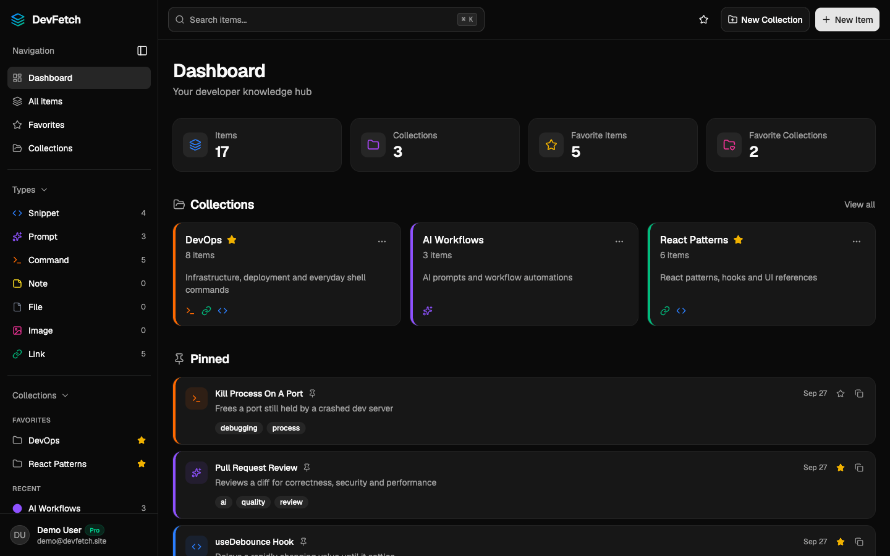
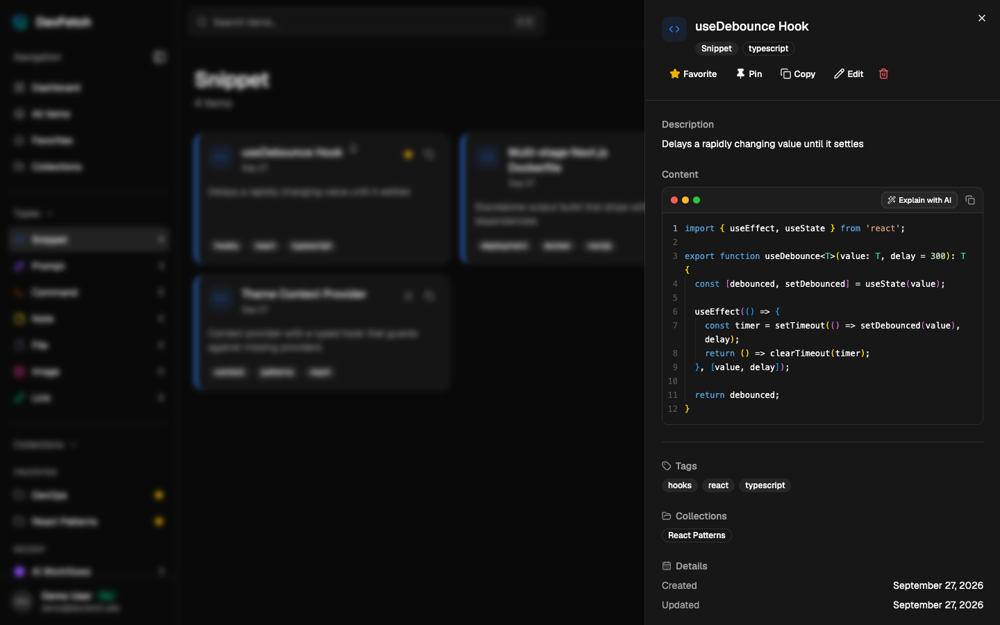
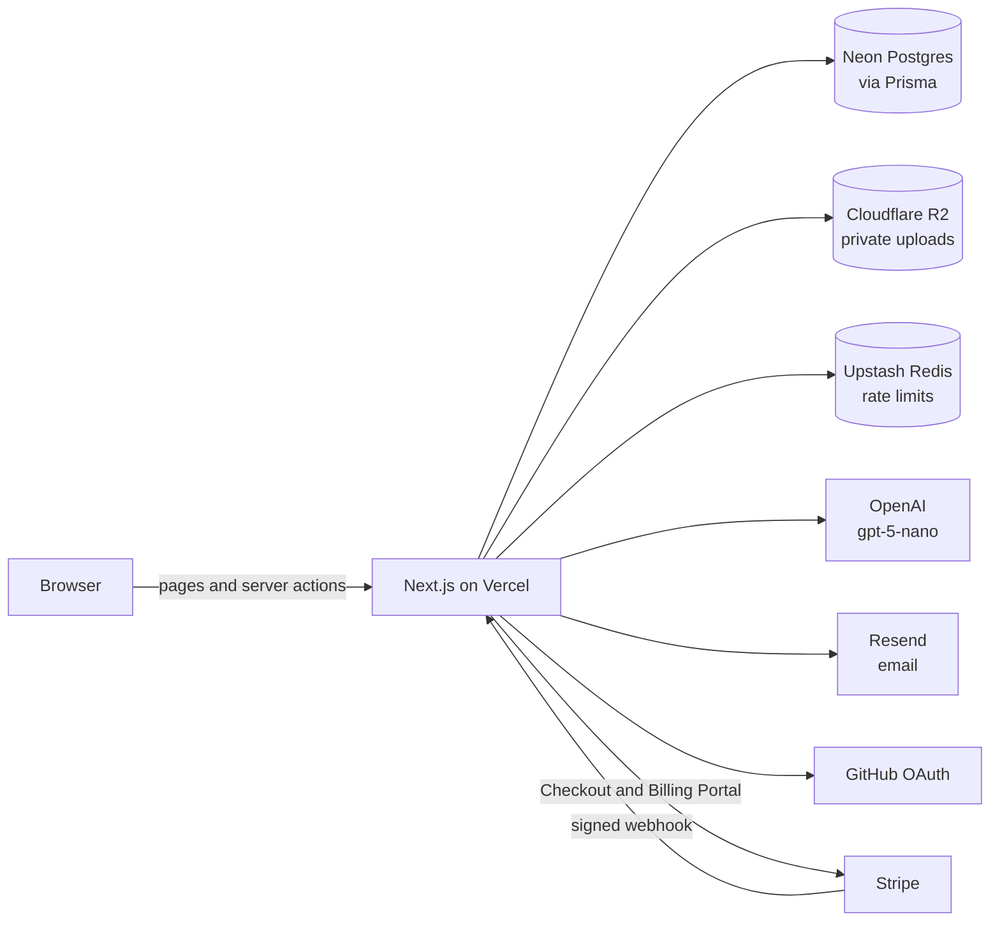

# DevFetch

A knowledge hub for developers that keeps snippets, commands, AI prompts, notes,
files and links in one searchable place, with AI tagging, summaries and code
explanations on a paid Pro plan.

**Live:** [devfetch.site](https://devfetch.site) — sign in with GitHub. Billing
runs in Stripe test mode, so card `4242 4242 4242 4242` with any future date
upgrades an account to Pro.



**Stack:** Next.js 16 (App Router) · React 19 · TypeScript · PostgreSQL on Neon
with Prisma 7 · NextAuth v5 · Stripe · OpenAI · Cloudflare R2 · Upstash Redis ·
Tailwind CSS v4 + shadcn/ui · Vercel

---



## Architecture



Pages are server components that query Postgres directly through Prisma.
Mutations are server actions validated with Zod. Route handlers cover the rest:
the Stripe webhook, file uploads and downloads, registration, email
verification, NextAuth, and the item drawer's fetch when a card is clicked.

## Decisions and trade-offs

**1. Ownership is checked in the `WHERE` of the write itself.**
Every update and delete is scoped as `{ id, userId }` in a single statement,
rather than reading the row to check its owner and then writing. That leaves no
gap between the check and the write, and someone else's item looks exactly like
one that doesn't exist. The cost: favoriting and pinning use raw SQL so they
don't move `updatedAt` and reorder the list, which gives up Prisma's type
checking for those two queries. Their tests pin the exact SQL to make up for it.

**2. Stripe is the source of truth; `isPro` is only a cache.**
The webhook takes nothing from an event except the customer ID, then asks Stripe
for that customer's current subscriptions, because Stripe doesn't guarantee
event order and a late event would otherwise overwrite a newer state. Checkout
also asks Stripe before opening a session. I learned this the hard way: while
the webhook was misconfigured, a test account was charged twice. The cost is an
extra Stripe API call per webhook and per repeat checkout.

**3. Pro status is read from the database on every request, not stored in the session.**
A JWT keeps whatever it held when it was issued, so a cancelled subscription
would keep granting Pro until the token refreshed. Reading the row costs one
query per request, cached for that request, and in return an upgrade or
cancellation takes effect on a plain page reload.

**4. Uploads are private and served through the app.**
R2 holds only object keys, never public URLs. Every file goes through a route
that checks the user owns the item naming it, sets the content type from the
file extension rather than what the browser claimed, and sends a sandboxing
CSP so an uploaded SVG can't run script. The cost is that files don't come from
a CDN, so every image load goes through the app.

**5. Rate limiting fails open for sign-in but closed for AI.**
If Redis goes down, sign-in keeps working, because an outage locking every user
out of their account is worse than a short window without limits. AI requests
are refused instead, because the limit is what caps the OpenAI bill. Same
dependency, opposite failure mode, chosen per feature.

## Running it locally

You need Node 20.9 or later and a Neon Postgres database. Everything else is
optional: without GitHub, Stripe, OpenAI, R2, Resend or Upstash keys, those
features are unavailable, but the app still builds and runs, and the
demo account signs in with email and password.

```bash
npm install            # also generates the Prisma client and copies Monaco into public/
cp .env.example .env   # fill in the values; every variable is documented there
npm run db:migrate     # apply the migrations
npm run db:seed        # demo account, 3 collections, 17 items
npm run dev            # http://localhost:3000
```

Sign in as `demo@devfetch.site` with password `12345678`. To skip email
verification locally, set `EMAIL_VERIFICATION="off"` in `.env`.

## How I used AI

Most of the code in this repo was written by [Claude Code](https://claude.com/claude-code).
My job was setting it up, making the calls and checking the work.

- **Specs and rules.** The product spec is in [`context/project-overview.md`](context/project-overview.md)
  and each feature has its own spec in [`context/features/`](context/features/).
  [`CLAUDE.md`](CLAUDE.md) and [`context/coding-standards.md`](context/coding-standards.md)
  set the rules it works under, such as no `any`, Zod on every input and never
  touching the production database.
- **A fixed workflow.** I built a Claude Code skill ([`.claude/skills/feature`](.claude/skills/feature/SKILL.md))
  that takes every feature through load → start → test → review → complete, on
  its own branch. Nothing is committed until the tests, lint and build pass and
  I approve it.
- **Decisions stay with me.** When a spec was ambiguous or a choice had a real
  trade-off, such as whether downgrading a plan hides content or leaves it
  read-only, the workflow stops and asks rather than guessing.
- **Checking, not trusting.** Each new test is checked by breaking the source
  and confirming the test fails. UI changes are verified in a real browser
  through Playwright. Custom review agents in [`.claude/agents/`](.claude/agents/)
  audit the codebase for security, auth, refactoring and UI issues, and I decide
  which findings to fix.
- **A written record.** [`context/current-feature.md`](context/current-feature.md)
  logs every feature: what was built, what was decided and why, and what went
  wrong along the way.
